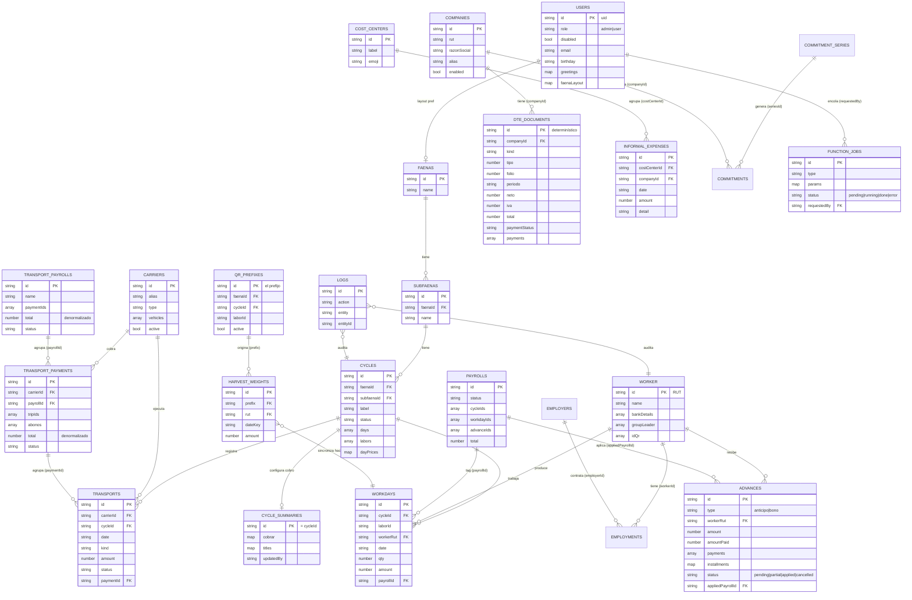

# Modelo de datos — Firestore (`hpdatabase`)

Sólo cabeceras de cada colección que la app está usando hoy. Tipos en notación informal: `string`, `number`, `bool`, `ts` (Timestamp), `ref→col` (id de doc en otra colección), `[]` (array), `{}` (objeto/map).

Convenciones comunes (todas las colecciones via `firestoreBase.createService`):
- `createdAt: ts`, `createdBy: string` (uid)
- `updatedAt: ts`, `updatedBy: string` (uid)

---

## Colecciones

### `faenas`
Lugar de trabajo (campo, predio).
| Campo | Tipo | Notas |
|---|---|---|
| `id` (docId) | string | autoId |
| `name` | string | |
| `notes` | string? | |

### `subfaenas`
Subdivisión dentro de una faena (cuartel, sector). Los ciclos siempre cuelgan de una.
| Campo | Tipo | Notas |
|---|---|---|
| `id` (docId) | string | autoId |
| `faenaId` | ref→`faenas` | |
| `name` | string | |
| `notes` | string? | |

### `cycles`
Período de trabajo en una subfaena. Contiene labores anidadas y la matriz de precios por día.
| Campo | Tipo | Notas |
|---|---|---|
| `id` (docId) | string | autoId |
| `faenaId` | ref→`faenas` | |
| `subfaenaId` | ref→`subfaenas` \| null | |
| `label` | string | prefijo + sufijo |
| `startDate` | string (YYYY-MM-DD) | |
| `status` | `"open"` \| `"closed"` | |
| `notes` | string? | |
| `days` | string[] | fechas YYYY-MM-DD |
| `labors` | `Labor[]` | embebido (ver abajo) |
| `dayPrices` | `{ [laborId]: { [date]: PriceEntry } }` | combos/tiers |
| `dayNotes` | `{ [date]: string }` | anotación compartida del día (click sobre el header) |
| `summaryTotals` | `{ pagar, cobrar, at }`? | totales del resumen del ciclo, escritos por `CycleSummaryModal` al cerrarse (solo si cambiaron). Alimentan el margen por ciclo del Dashboard: van acá y no en `cycleSummaries` porque el Dashboard ya carga la lista de ciclos y así le salen gratis. Ausente en los ciclos cuyo resumen nunca se abrió. |

`Labor` (embebido en `cycles.labors`):
- `id`, `name`, `type` (`cosecha` \| `trato` \| `tratoHE` \| `main` \| `supervision` \| `extra`)
- `laborGroupId?: ref→laborGroups` — hila esta labor con las de mismo tipo en otros ciclos de la misma subfaena (ej. "Poda" del ciclo pasado con "Poda" del actual). Opcional, aditivo — `workdays`/`payroll` siguen usando `cycleId`+`laborId` (el id local del ciclo) igual que siempre; esto no lo reemplaza.
- `workers: WorkerEntry[]` — referencias al trabajador, no solo RUT:
  - `rut`, `name`
  - `isTemp?: bool` — trabajador temporal (sin RUT real); convertirlo via "Asignar RUT"
  - `groupLeader?: string` — solo para temps (los reales lo tienen en `worker.groupLeader`)
  - `monthly?: bool` — sueldo mensual: las celdas pasan a checkbox de asistencia, workdays con `amount: 0` y `attendanceOnly: true`, excluidos de la nómina, badge "M". Se usa en labores al día (`main`, `supervision`, `extra`) y en `tratoHE`
- `baseDayDefault?`, `bonusManejo?`, `bonusSupervision?`, `overtimeRate?`

### `laborGroups`
Agrupación de labores a través de ciclos, scoped a una subfaena (puede haber varias por subfaena: Poda, Riego, etc.). Renombrar el grupo no reescribe retroactivamente el `name` de las labores ya vinculadas — cada ciclo conserva el nombre que tenía al crearse.
| Campo | Tipo | Notas |
|---|---|---|
| `id` (docId) | string | autoId |
| `subfaenaId` | ref→`subfaenas` | |
| `name` | string | |
| `active` | bool | |

### `worker` (singular en Firestore)
Trabajador. **DocId = rut con el que se creó** (ej. `12345678-9`, `12345678-B`) — pero
desde la migración "rut editable" (fase 1) ese id se trata como un **`workerId`
estable**: nunca se vuelve a tocar aunque el rut legal cambie después (Firestore
no soporta rename de doc id). El rut ACTUAL vive en el campo `rut`, editable —
arranca igual al id pero puede divergir (típico: trabajador con cédula de
extranjería provisoria `-B`/`-H` que después obtiene rut definitivo). Todo lo
que necesite identidad estable (agrupar workdays, nóminas, auditoría) debe usar
el id/workerId, nunca el campo `rut`.
| Campo | Tipo | Notas |
|---|---|---|
| `id` (docId) | string | `workerId` estable — rut de creación, no cambia nunca |
| `rut` | string | rut legal ACTUAL, editable (campo agregado en fase 1; workers viejos necesitan backfill, ver AdminConsole → "Backfill: campo rut en trabajadores") |
| `name` | string | UPPERCASE típicamente |
| `email` | string? | |
| `bankDetails` | `[paymentRut, accountNumber, accountType, bankCode]` | tupla. accountType: 0 cta corriente, 1 cta vista, 3 cuenta RUT. bankCode `EFE` = efectivo. |
| `paymentName` | string? | nombre de a quién se le paga: el titular de la cuenta o, en efectivo, quien cobra. Obligatorio cuando `paymentRut` es de otra persona (`paysToOtherPerson`, `utils/banks.js`); opcional si es el mismo RUT del trabajador |
| `groupLeader` | string[] | historial; `[0]` = actual (ej. `CHILENOS`, `EXTRANJEROS`) |
| `idQr` | string[] | códigos QR asignados |
| `address`, `commune` | string? | dirección y comuna; las piden las boletas de honorarios |
| `nationality` | string? | texto libre ("Chilena") |
| `maritalStatus` | `"single"` \| `"married"` \| `"civilUnion"` \| `"divorced"` \| `"widowed"` \| `""` | |
| `birthDate` | string (YYYY-MM-DD)? | |
| `pensionFund` | string? | nombre de la AFP |
| `healthInsurance` | string? | "Fonasa" o el nombre de la Isapre |
| `updatedAt` | timestamp | lo pone el servicio en cada escritura de TeRRa. La lista de trabajadores del navegador se pone al día con él (`listWorkers`, `services/workersService.js`). El escáner escribe sin él: lo suyo entra con la carga completa diaria, igual que una eliminación hecha en otro equipo |

**Búsqueda**: `findWorkerByRut()` resuelve por **las dos vías** — primero el docId, y si no hay, por el campo `rut`. Un rut que se escribió en otro documento (`workday.workerRut`, `harvestWeights.rut`, items de nómina) puede ser cualquiera de los dos según cuándo se creó, así que buscar solo por docId pierde a los que corrigieron su cédula. Quien necesite **escribir** contra el trabajador encontrado tiene que usar el `.id` del doc devuelto, nunca el rut con el que buscó.

### `workdays`
Una fila por (cycleId × laborId × workerRut × date). Es la tabla "transaccional" de producción.
| Campo | Tipo | Notas |
|---|---|---|
| `id` (docId) | string | compuesto: `${cycleId}__${laborId}__${rut}__${date}[__${comboKey}]` (ver `utils/cosechaCombos.js` → `workdayDocId`). El segmento de rut queda congelado con el valor que tenía el worker AL CREAR el workday — no se reescribe si el trabajador edita su rut después. |
| `cycleId` | ref→`cycles` | |
| `laborId` | string | id dentro de `cycles.labors` |
| `workerRut` | string | rut del trabajador AL MOMENTO de crear/editar este workday — puede quedar desactualizado si el trabajador edita su rut después |
| `workerId` | ref→`worker` (por id, estable) | agregado en fase 2 de la migración "rut editable"; es la forma correcta de unir con el worker, no `workerRut`. Workdays viejos (pre-migración) no lo tienen — fallback a `workerRut` en ese caso |
| `date` | string (YYYY-MM-DD) | |
| `qty` | number? | kilos / cantidad |
| `qualityX`, `containerY` | number? | ejes del combo (cosecha) |
| `amount` | number | $ calculado |
| `payrollId` | ref→`payrolls` \| null | tag al liquidar |
| `payrollTaggedAt`, `payrollTaggedBy` | ts, string? | |
| `paidAt`, `paidBy` | ts?, string? | sello al marcar pagado |
| `attendanceOnly` | bool? | `true` para asistencia de trabajador mensual (amount = 0, no entra al payroll) |
| `tiers` | `{ [tierKey]: { qty, amount } }` | trato multi-precio; suma con `getTratoTierTotals(wd)` |
| `overtimeHours`, `hasManejo`, `hasSupervision`, `extras` | number? / bool? | solo `tratoHE` |
| `pisoOnly` | bool? | `true` para workdays de piso (combo `_piso`). `qty: 0`, `amount: pisoAmount`. Un doc por (worker × date × labor). Solo trato/cosecha. Tag con `payrollId` igual que cualquier otro workday. |

### `payrolls`
Nómina = lote de pago. Agrupa `workdayIds` y `advanceIds`.
| Campo | Tipo | Notas |
|---|---|---|
| `id` (docId) | string | autoId |
| `name` | string | |
| `format` | string | el formato del archivo del banco configurado al generarla (`payrollConfig/main.bankFormat`, ej. `"pagoFacilBchile"`). Las nóminas anteriores dicen `"bchile"`, que es el mismo formato. Es solo un registro: las descargas usan el formato configurado al descargar |
| `status` | `"pending"` \| `"paid"` | binario. Una nómina con las transferencias pagadas y el efectivo debiendo sigue siendo `pending` |
| `paidAt` | string (ISO) \| null | |
| `bankPaidAt`, `bankPaidBy` | string (ISO)? / string? | **pago en dos tiempos**: salieron las transferencias pero el efectivo no. Es el flag que convierte el efectivo de esta nómina en *deuda* |
| `cashPaidRuts` | string[] | ruts de efectivo que ya cobraron sueltos; se descuentan de la deuda. NO estampan `paidAt` en sus workdays |
| `cycleIds` | string[] | refs a `cycles` |
| `cycleLabels` | snapshot | |
| `cycleDetails` | `{ id, label, faena…, firstDay, lastDay, laborIds? }[]` | `label`, `faenaName`, `subfaenaName`: los nombres al generar, que Recalcular pone al día. `firstDay`/`lastDay`: primer y último día que la nómina le paga al ciclo (de sus jornadas); se ponen al día al recalcular y al agregar. Las nóminas anteriores guardan el rango de `cycle.days` hasta que se recalculan. `laborIds`: qué labores del ciclo le pertenecen a la nómina (lo que Recalcular puede traer). Sin el campo = el ciclo entero; `[]` = solo días puntuales de personas, elegidos a mano al generar o con "+ Agregar persona". Sacar labores en el detalle las quita de la lista, y un ciclo que estaba entero pasa a llevar la lista de las que le quedan; sacar el ciclo entero lo quita de `cycleIds`, `cycleLabels` y `cycleDetails`. Ver "Agrandar" y "Achicar una nómina pendiente" en `docs/screens/payroll.md` |
| `items` | `PayrollItem[]` | snapshot por trabajador |
| `total`, `bankTotal`, `cashTotal` | number | |
| `workerCount`, `bankCount`, `cashCount` | number | |
| `workdayIds` | ref→`workdays`[] | |
| `advanceIds` | ref→`advances`[] | |
| `advanceTotal` | number | |

`PayrollItem` (embebido):
- `rut` (el campo real en código es `rut`, no `workerRut` a pesar de lo que sugiere el nombre del doc — mismatch histórico), `workerId` (agregado en fase 2, ref estable al worker), `workerName`, `bankDetails`
- `amount`, `advance`, `anticiposTotal`, `adelantosTotal` (**legacy: siempre 0** de acá en adelante; se sigue escribiendo solo para que los snapshots viejos se lean igual)
- `paymentRut`, `paymentName`, `accountNumber`, `bankCode`, `accountType`, `email`, `groupLeader`: los datos de cuenta y de grupo de la ficha al generar, al agregar a la persona o al recalcular. `paymentName` es el titular de la cuenta (`worker.paymentName`; vacío si la ficha no lo tiene) y el archivo del banco lo usa cuando la cuenta es de otra persona; las nóminas anteriores al campo no lo traen hasta que se recalculan
- `byCycle: { [cycleId]: {...} }`
- `workdayIds: string[]`, `advanceIds: string[]`

### `payrollConfig`
Configuración compartida de la nómina. **Un único doc `payrollConfig/main`**; sin él valen los valores por defecto. Lo cambia un admin desde Nómina → ⚙ Configuración (las reglas no distinguen el rol, igual que `commitmentConfig`).
| Campo | Tipo | Notas |
|---|---|---|
| `id` (docId) | string | siempre `"main"` |
| `bankFormat` | string | id del formato del archivo del banco (`utils/bankFormats.js`); por defecto `"pagoFacilBchile"`. Lo usan "🏦 Sólo Nómina" y la primera hoja del XLSX completo, también al volver a descargar una nómina anterior |

### `payrollSnapshots`
Snapshot JSON inmutable de cada nómina, separado del documento de `payrolls` para no engordar la lista. Lo escribe la app al generar la nómina y lo consume el **portal de trabajadores** (read-only) para construir su resumen.
| Campo | Tipo | Notas |
|---|---|---|
| `id` (docId) | string | mismo id de la `payroll` (1:1) |
| `payrollId` | ref→`payrolls` | |
| `generatedAt` | string (ISO) | |
| `name`, `format`, `status` | string | snapshot de la payroll |
| `cycleIds`, `cycleLabels`, `cycleDetails` | snapshot | |
| `items` | `PayrollItem[]` | trabajadores + amounts (mismo shape que `payrolls.items`) |
| `total`, `bankTotal`, `cashTotal`, `advanceTotal` | number | |
| `workerCount`, `bankCount`, `cashCount` | number | |

> Se baja como `.json` desde el detalle de la nómina (📥 Descargar → JSON).

### `portalPayslips`
Ficha de un trabajador en la nómina publicada en el portal de trabajadores. La escribe solo el job `publishPortal` (`functions/portal.js`); se lee sin sesión y de a un documento (`firestore.rules`).
| Campo | Tipo | Notas |
|---|---|---|
| `id` (docId) | string | RUT normalizado: sin puntos, en mayúsculas, con guion (`12345678-9`) |
| `payrollId` | ref→`payrolls` | la nómina de la ficha. Si no es el de `portalMeta/current`, el portal la trata como no encontrada |
| `version`, `generatedAt` | | del snapshot |
| `payroll` | `{ name, status }` | vivos de `payrolls` al publicar |
| `workers` | `[PayrollItem]` | **un solo** trabajador, solo con `rut`, `name`, `groupLeader`, `bankCode`, `accountType`, `accountNumber` (**últimos 4 dígitos**), `grossAmount`, `advance`, `bonus`, `amount`, `byCycle`, `anticipoApplications` y `bonoApplications` |
| `cycles` | snapshot | solo los ciclos donde trabajó, sin `dayPrices` |
| `workdays` | snapshot | solo sus jornadas, con `workerRut` igual al `rut` de la ficha |
| `advances` | snapshot | solo sus anticipos y bonos |
| `publishedAt` | string (ISO) | |

### `portalMeta`
Un solo documento, `current`: la cabecera de la nómina publicada en el portal. Lo escribe el job `publishPortal`.
| Campo | Tipo | Notas |
|---|---|---|
| `payrollId` | ref→`payrolls` | |
| `version`, `generatedAt` | | del snapshot |
| `payroll` | `{ name, status }` | |
| `workerCount` | number | fichas publicadas |
| `publishedAt` | string (ISO) | |
| `publishedBy` | string | uid del admin que publicó |

### `interestLinks`
Atajos a herramientas externas mostrados en `/links`. CRUD con reordenamiento drag-and-drop.
| Campo | Tipo | Notas |
|---|---|---|
| `id` (docId) | string | autoId |
| `text` | string | etiqueta visible |
| `url` | string | URL normalizada (`https://...`) |
| `order` | number? | índice ascendente; sin valor → ordena al final alfabéticamente |

### `advances`
Anticipos (descuento) y bonos (suma) sobre la próxima nómina. El signo lo da `type`, no el monto: `amount` siempre es positivo.
| Campo | Tipo | Notas |
|---|---|---|
| `id` (docId) | string | autoId |
| `type` | `"anticipo"` \| `"bono"` | `anticipo` descuenta (sign −1), `bono` suma (+1). El legacy `"adelanto"` se normaliza a `"anticipo"` **al leer** (`normalizeAdvanceType`) — los docs viejos conservan ese valor en Firestore, no hubo backfill |
| `workerRut` | string | rut al momento de crear el anticipo |
| `workerId` | ref→`worker` (por id, estable) | agregado en fase 2; fallback a `workerRut` en anticipos viejos |
| `workerName` | string | snapshot |
| `amount` | number | total comprometido |
| `amountPaid` | number | denormalizado = Σ `payments[].amount`; el saldo es `advanceRemaining() = amount − amountPaid` |
| `payments` | `[{ payrollId, amount, paidAt }]` | append-only. **No queda ordenado por fecha**: revertir una nómina filtra entradas del medio (`restoreAdvancesFromPayroll`), así que para "última cuota" hay que tomar el MÁXIMO `paidAt`, nunca el último elemento |
| `date` | string (YYYY-MM-DD) | |
| `note` | string? | |
| `status` | `"pending"` \| `"partial"` \| `"applied"` \| `"cancelled"` | `partial` = `amountPaid > 0` pero menor a `amount`; sigue siendo cobrable. Los docs legacy sin `status` se tratan como `pending` |
| `installments` | `{ count, amount, cadence }` \| null | plan de cuotas, **solo para `anticipo`**. Se fija al crear y no se edita después (para cambiarlo hay que borrar y recrear). `amount = Math.ceil(total/count)` — ceil a propósito: `count` cuotas siempre cubren el total y la última queda más chica sola, sin llevar la cuenta de en qué cuota va. `cadence` (`porPago` \| `quincenal` \| `mensual`) es una **etiqueta informativa, no un gate por fecha**: no hay cron en la app, el admin confirma a mano qué cuotas entran al generar cada nómina |
| `appliedPayrollId` | ref→`payrolls` \| null | última nómina que lo tocó (legacy — el detalle real vive en `payments[]`) |
| `appliedAt`, `appliedBy` | ts?, string? | |

> **Ojo con los filtros**: `pending` y `partial` van juntos en el bucket "Pendientes" (`Advances.jsx` → `STATUS_BUCKET`, y `listPendingForWorkers()`). Un parcial que quede fuera de ese bucket desaparece de la vista sin que su saldo deje de existir.

### `employers`
Empresas empleadoras de los contratos y los honorarios (Transporte HP, Frutos La Aguada…). Lista propia, aparte de las `companies` de Facturación.
| Campo | Tipo | Notas |
|---|---|---|
| `id` (docId) | string | autoId |
| `name` | string | |
| `rut` | string | normalizado `"76123456-7"` |
| `enabled` | bool | un empleador desactivado no se ofrece para períodos nuevos |

### `employments`
Un período de contrato o de honorarios de un trabajador con un empleador. El historial de una persona es la lista de sus períodos; "sin nada" es no tener ninguno vigente.
| Campo | Tipo | Notas |
|---|---|---|
| `id` (docId) | string | autoId |
| `workerId` | ref→`worker` (por id, estable) | |
| `workerRut`, `workerName` | string | copia al crear, para mostrar sin cruzar con `worker` |
| `type` | `"contract"` \| `"fees"` | contrato u honorarios |
| `employerId` | ref→`employers` | |
| `startDate` | string (YYYY-MM-DD) | |
| `endDate` | string (YYYY-MM-DD) \| `""` | `""` = sin término. Con una fecha futura (plazo fijo) sigue vigente hasta ese día. **Vigente en `d`**: `startDate <= d` y (`endDate` vacío o `endDate >= d`) |
| `endReason` | `"jobEnd"` \| `"companyNeeds"` \| `"resignation"` \| `"mutualAgreement"` \| `"other"` \| null | término de faena, necesidad de la empresa, renuncia, mutuo acuerdo |
| `settlementStatus` | `"pending"` \| `"requested"` \| `"done"` \| null | el finiquito; solo en contratos terminados. Terminar un contrato lo deja en `pending` |
| `settlementRequestedAt`, `settlementDoneAt` | string (YYYY-MM-DD)? | cuándo se pidió al contador y cuándo quedó listo |
| `notes` | string | |

> **Dos períodos de una persona no se cruzan** (`employmentError`, `utils/employment.js`): su estado en una fecha es uno solo. Las consultas van por un solo campo (`endDate == ""`, `endDate >= fecha`, `workerId`, `settlementStatus in`, `settlementDoneAt >=`) y no necesitan índice compuesto.

### `feeLists`
Una lista de boletas de honorarios: las personas a honorarios con un empleador en un rango de fechas, con sus días y montos. Es un registro: guarda la tarifa, los datos de cada persona y los montos tal como estaban al generarla.
| Campo | Tipo | Notas |
|---|---|---|
| `id` (docId) | string | autoId |
| `employerId`, `employerName` | ref→`employers`, string | el nombre, copiado al generar |
| `from`, `to` | string (YYYY-MM-DD) | el rango de las jornadas |
| `dailyNet` | number | líquido por día con que se generó |
| `withholdingRate` | number | retención de la boleta (0,1525 = 15,25%) |
| `items` | `[{ workerId, rut, name, faenaId, faenaName, days, net, withholding, gross, address, commune, issued, folio, issuedAt }]` | una fila por persona y faena. Bruto por día = `round(dailyNet / (1 − withholdingRate))`; bruto = días × eso; retención = bruto − líquido (`feeAmounts`, `utils/employment.js`). `issued`, `folio` e `issuedAt`: la boleta emitida |
| `totals` | `{ people, days, gross, withholding, net, issued, count }` | denormalizado de `items` (`feeListTotals`), para la lista de la pestaña |

### `contributionLists`
Una lista de imposiciones para el contador: por empleador y mes, los días imponibles de cada persona con contrato, por faena (el centro de costo). Sueldo y bono los completa el contador. Es un registro: guarda las filas como estaban al generarla.
| Campo | Tipo | Notas |
|---|---|---|
| `id` (docId) | string | autoId |
| `employerId`, `employerName` | ref→`employers`, string | el nombre, copiado al generar |
| `month` | string (YYYY-MM) | |
| `items` | `[{ workerId, rut, name, faenaId, faenaName, days, request, endDate, endReason }]` | una fila por persona y faena; quien tuvo contrato y no trabajó va con `faenaId: ""` y 0 días. `request`: `"payslip"` (liquidación) o `"payslipAndSettlement"` (liquidación y finiquito, si el contrato terminó ese mes, con `endDate` y `endReason`) |
| `totals` | `{ people, days, count, settlements }` | denormalizado de `items` (`contributionTotals`) |
| `sentAt` | string (YYYY-MM-DD) \| `""` | cuándo se marcó enviada al contador |

### `employmentConfig`
Configuración de contratos y honorarios. Un solo documento, `main`.
| Campo | Tipo | Notas |
|---|---|---|
| `feeDailyNet` | number | líquido por día de una boleta de honorarios (por defecto 18.452) |
| `feeWithholdingRate` | number | retención de la boleta (por defecto 0,1525, la de 2026) |

### `carriers`
Transportistas (propios o contratados).
| Campo | Tipo | Notas |
|---|---|---|
| `id` (docId) | string | autoId |
| `alias`, `name` | string | |
| `type` | `"own"` \| `"contracted"` | |
| `defaultRate` | number | |
| `vehicles` | `[{alias, plate?, capacity?, notes?}]` | |
| `notes` | string? | |
| `active` | bool | soft delete |

### `transports` (vueltas / viajes)
| Campo | Tipo | Notas |
|---|---|---|
| `id` (docId) | string | autoId |
| `carrierId` | ref→`carriers` | |
| `vehicleAlias` | string | |
| `cycleId` | ref→`cycles` | |
| `faenaId`, `subfaenaId` | ref \| null | |
| ~~`laborId`~~ | — | **No llega a Firestore.** `TripEditModal` lo pide y lo manda en el payload, pero `normalizeTrip()` (transportsService.js) no lo copia al doc, así que nunca se escribe ni lo lee nadie. Hoy es una entrada de usuario que se descarta en silencio: o se saca del form, o se agrega a `normalizeTrip`. |
| `date` | string (YYYY-MM-DD) | |
| `kind` | `"regular"` \| `"approach"` | |
| `qty`, `rate`, `amount` | number | `amount = qty * rate` |
| `lugar`, `destino` | string? | |
| `personCount` | number? | |
| `notes` | string? | |
| `status` | `"pending"` \| `"paid"` | una vuelta `paid` queda congelada: `tripsService.update`/`remove` la rechazan |
| `paymentId` | ref→`transportPayments` \| null | null = "vuelta suelta", disponible para entrar a un resumen nuevo |

### `transportPayments`
Resumen de pago a un transportista (lote de `transports`).
| Campo | Tipo | Notas |
|---|---|---|
| `id` (docId) | string | autoId |
| `carrierId` | ref→`carriers` | |
| `periodFrom`, `periodTo` | string (YYYY-MM-DD) \| null | **snapshot del rango con que se creó el resumen**; no se recalcula al agregarle vueltas después, así que puede quedar más angosto que las fechas reales de `tripIds` |
| `groupBy` | `"day"` \| ... | |
| `tripIds` | ref→`transports`[] | |
| `total` | number | **denormalizado** = Σ `amount` de las vueltas vivas. Lo mantiene el servicio (`recalcPaymentTotal`), no las pantallas — ver "Totales denormalizados" abajo |
| `abonos` | `[{ id, amount, date, notes, createdAt, createdBy, updatedAt?, updatedBy? }]` | pagos parciales antes de marcar el resumen 100% pagado. El pendiente se calcula en cliente (`total − Σ abonos`); **no** descuenta de `total`. `updatedAt`/`updatedBy` aparecen cuando un abono se corrige (`updateAbono`), que conserva su `id` y su `createdAt` |
| `payrollId` | ref→`transportPayrolls` \| null | null = resumen "suelto", disponible para entrar a una quincena |
| `status` | `"pending"` \| `"paid"` | `paid` congela el doc: no se recalcula ni se edita |
| `paidAt`, `paidBy` | ts?, string? | |
| `notes` | string? | |

### `transportPayrolls` (quincenas)
Agrupa N `transportPayments` de **varios** transportistas para pagar en bloque. Relación 1:N estricta: un resumen pertenece a una quincena o a ninguna.
| Campo | Tipo | Notas |
|---|---|---|
| `id` (docId) | string | autoId |
| `name` | string | obligatorio (ej. "Primera Quincena Agosto") |
| `periodFrom`, `periodTo` | string (YYYY-MM-DD) \| null | referencial: el agrupamiento es lógico, no un filtro estricto por fecha |
| `paymentIds` | ref→`transportPayments`[] | |
| `total` | number | **denormalizado** = Σ `total` de sus resúmenes (`recalcFortnightTotal`) |
| `status` | `"pending"` \| `"paid"` | |
| `paidAt`, `paidBy` | ts?, string? | |
| `notes` | string? | |

> **Cascada de pago**: marcar la quincena pagada marca cada resumen y cada vuelta de cada resumen. Marcar un item suelto marca solo ese resumen y sus vueltas — la quincena sigue `pending` hasta que se marque explícitamente. Revertir hace la cascada inversa.

### `companies`
Empresas (emisoras/receptoras) del módulo de Facturación. Multi-empresa: el usuario elige cuál opera y se persiste en `localStorage`.
| Campo | Tipo | Notas |
|---|---|---|
| `id` (docId) | string | autoId |
| `rut` | string | normalizado `"76123456-7"` (`normalizeRut`) |
| `razonSocial` | string | |
| `alias` | string | display; default = `razonSocial` |
| `enabled` | bool | |

### `dteDocuments`
Documento tributario electrónico (factura / boleta / NC / etc.) importado del **RCV del SII**. **DocId determinístico** (`buildDteDocId`) para que reimportar el mismo período sea idempotente:
- ventas: `{companyId}_V_{tipo}_{folio}`
- compras: `{companyId}_C_{rutProveedorNumérico}_{tipo}_{folio}`

| Campo | Tipo | Notas |
|---|---|---|
| `id` (docId) | string | determinístico (ver arriba) |
| `companyId` | ref→`companies` | empresa dueña |
| `companyAlias` | string | snapshot |
| `kind` | `"venta"` \| `"compra"` | detectado del header del CSV |
| `tipo` | number | código DTE del SII (33, 34, 61, 112, …) |
| `tipoLabel` | string | label legible (`dteTypeLabel`) |
| `folio` | number | |
| `fechaEmision` | string (YYYY-MM-DD) | |
| `periodo` | string (YYYY-MM) | derivado de `fechaEmision`; clave de filtro/agrupación (incl. tab Resumen) |
| `rutEmisor`, `razonSocialEmisor` | string | en ventas el emisor somos nosotros |
| `rutReceptor`, `razonSocialReceptor` | string | en compras el receptor somos nosotros |
| `exento`, `neto`, `iva`, `otrosImpuestos`, `total` | number | montos. **NCs (61/112) restan con signo** en los totales de la UI |
| `otroImpuestoCodigo` | number? | "Código Otro Impuesto" del RCV (**28/35/271/272 = combustible**) |
| `otroImpuestoCategory` | string? | `combustible` \| `alcohol` \| `tabaco` \| `bebidas` \| `otros` |
| `source` | `"sii_import"` | |
| `sourceFile` | string | filename original del CSV |
| `paymentStatus` | `"unpaid"`\|`"paid"`\|`"net_only"`\|`"factored"`\|`"cancelled"` | default `unpaid` al importar; **preservado al reimportar** |
| `amountPaid` | number | denormalizado = `Σ payments[].amount` |
| `payments` | `Payment[]` | abonos (ver abajo) |
| `notes` | string? | notas editables / auditoría de anulación por NC |
| `importedAt`, `importedBy` | ts, string? | sello del import (writeBatch chunks de 450) |

`Payment` (embebido en `dteDocuments.payments`):
- `id` (local), `date` (YYYY-MM-DD), `kind` (`abono` \| `neto` \| `iva` \| `total`), `amount: number`, `notes: string`
- **Invariante**: `Σ amount ≤ total` (validado al guardar).

### `costCenters`
Centros de costo **ficticios** del Libro de Facturación — catálogo global (compartido entre empresas) para etiquetar a mano documentos que no calzan con la agrupación por proveedor (ej. "Arriendo", "Mantención"). "Combustibles" no vive acá: se deriva 100% del código de otro impuesto del SII.
| Campo | Tipo | Notas |
|---|---|---|
| `id` (docId) | string | autoId |
| `label` | string | |
| `emoji` | string \| null | |

### `informalExpenses`
Gastos sin respaldo tributario (sin factura/boleta, o con boleta nunca ingresada al SII). **Puramente informativos**: no son `dteDocuments`, no se mezclan con la data fiscal y solo se muestran dentro de la vista de un centro de costo.
| Campo | Tipo | Notas |
|---|---|---|
| `id` (docId) | string | autoId |
| `costCenterId` | ref→`costCenters` | |
| `companyId` | ref→`companies` \| null | opcional: gasto sin empresa asignada |
| `date` | string (YYYY-MM-DD) | |
| `amount` | number | |
| `detail` | string | |

### `commitments`
Un vencimiento de la pantalla **Cheques y pagos**: un cheque emitido o recibido, un pago comprometido, una cuota de crédito o un mes de un pago recurrente. De acá sale el correo diario de avisos (`functions/commitments.js`).
| Campo | Tipo | Notas |
|---|---|---|
| `id` (docId) | string | autoId; `chq_{banco}_{N°}` si vino de la planilla de cheques (reimportar no duplica); `{seriesId}_{dueDate}` si lo generó una serie |
| `kind` | `"chequeIssued"` | `"chequeReceived"` | `"payment"` | `"installment"` | `"personalDebt"` | `chequeReceived` es plata que entra; el resto, plata que sale. `personalDebt` (deuda personal) es un pago único o, en cuotas, una serie como la de un crédito |
| `dueDate` | string (YYYY-MM-DD) | fecha del cheque o del vencimiento; es la que dispara los avisos |
| `issueDate` | string | opcional, solo cheques |
| `amount` | number | CLP; el monto original del vencimiento |
| `extra` | number? | lo que se pagó por sobre `amount` (interés por atraso u otro recargo), en cualquier tipo. Se anota al marcar pagado y vuelve a `0` al pasar a cualquier otro estado; solo cuenta con `status: "paid"` (`extraOf`). Lo pagado es `amount + extra` |
| `counterparty` | string | beneficiario, quien entrega el cheque o acreedor (`toTitleName`) |
| `concept`, `notes` | string | (`unshout`) |
| `bank` | string | código de `utils/banks.js`, o el texto de la planilla si no se reconoció; vacío fuera de cheques |
| `chequeNumber` | string | vacío fuera de cheques |
| `companyId` | ref→`companies` | null | cuenta / empresa |
| `companyLabel` | string | la empresa como venía en la planilla cuando no calzó con `companies` |
| `status` | `"pending"` | `"postponed"` | `"protested"` | `"paid"` | `"cancelled"` | **"vencido" no se guarda**: es `pending` con `dueDate` pasada. `postponed` (aplazado): ya venció, se sigue debiendo y no tiene fecha de pago. `protested`: cheque rechazado por el banco, se sigue debiendo (o cobrando). Lo aplazado va en el correo de avisos junto a los próximos vencimientos, pero por sí solo no lo genera; lo protestado no va. "Reprogramar" los devuelve a `pending` con un `dueDate` nuevo |
| `paidAt` | string (YYYY-MM-DD) | fecha en que se cobró o pagó; `""` si no |
| `partialPayments` | `[{ id, date, amount, notes, groupId?, groupTotal?, createdAt, createdBy }]`? | abonos (pagos parciales), hoy solo en deudas personales. Lo que falta pagar de algo abierto es `amount` menos su suma (`remainingOf`), y es lo que cuentan los totales, el informe y el correo. Un abono a toda la deuda se reparte entre sus cuotas abiertas, de la más antigua a la más nueva, y cada parte lleva el mismo `groupId` (y en `groupTotal` el abono completo); se quita entero |
| `closedByPartials` | bool? | `true` si quedó `paid` porque los abonos cubrieron el monto (con `paidAt` = fecha del último abono): quitar un abono lo devuelve a `pending`. Si se marcó pagado a mano es `false`, y sus abonos no se quitan sin volverlo antes a pendiente |
| `seriesId` | ref→`commitmentSeries`? | si lo generó un crédito o un pago recurrente |
| `installment` | `{ n, of }` | null | número de cuota; `null` en un pago recurrente |
| `source` | `"excel_import"`? | solo lo importado de la planilla |

### `commitmentSeries`
Un crédito en cuotas (`kind: "installment"`), una deuda personal en cuotas (`kind: "personalDebt"`) o un pago recurrente mensual (`kind: "payment"`). Los vencimientos son docs propios de `commitments`, con el mismo `kind` de la serie; la serie solo los genera.
| Campo | Tipo | Notas |
|---|---|---|
| `id` (docId) | string | autoId |
| `kind`, `counterparty`, `concept`, `notes`, `amount`, `companyId` | | se copian a cada vencimiento. En un recurrente, `amount` es el de los vencimientos que se generen de ahí en adelante y cambia al ajustar el monto de la serie |
| `frequency` | `"monthly"` | |
| `firstDate` | string (YYYY-MM-DD) | primer vencimiento; los siguientes caen el mismo día de cada mes (recortado al largo del mes) |
| `dayOfMonth` | number? | solo recurrentes: el día de pago, si se cambió después de crear la serie ("Ajustar todos los vencimientos"). Sin el campo, vale el día de `firstDate` |
| `count` | number | null | cuotas de un crédito (se crean todas al principio); `null` = pago recurrente sin término |
| `active` | bool | `false` al detener un recurrente: se borran sus pendientes futuros y no se generan más |
| `generatedUntil` | string (YYYY-MM-DD)? | solo recurrentes: hasta dónde se generaron vencimientos. La función diaria lo extiende a hoy + 60 días; un vencimiento que alguien eliminó antes de esa fecha no se vuelve a crear. Al ajustar la serie se adelanta al último vencimiento, si quedó más allá, para no generar dos veces el mismo mes |

### `commitmentConfig`
Un único doc `main` con la configuración de los avisos por correo.
| Campo | Tipo | Notas |
|---|---|---|
| `recipients` | string[] | correos en minúscula |
| `offsets` | number[] | días de anticipación, de mayor a menor (default `[3, 1, 0]`) |
| `includeOverdue` | bool | repetir cada día los vencidos sin marcar |
| `sender` | string | cuenta Gmail que envía; su contraseña de aplicación es el secreto `SMTP_PASS` del backend |

### `commitmentNotifications`
Registro de los correos diarios. Lo escribe solo la función `commitmentsDaily`; la app lo lee (`firestore.rules`). El doc se crea **antes** de enviar y hace de candado: un reintento del mismo día no repite el correo. Si el envío falla, se borra para que el reintento pueda enviarlo.
| Campo | Tipo | Notas |
|---|---|---|
| `id` (docId) | string (YYYY-MM-DD) | día en Chile |
| `status` | `"sending"` | `"sent"` | |
| `recipients` | string[] | |
| `count`, `total` | number | vencimientos avisados y su suma, sin la sección de próximos |
| `sections` | `[{ key, ids[] }]` | qué se avisó en cada grupo (`overdue`, `d0`, `d1`, `d3`…) y `upcoming`: los próximos 7 días que se sumaron, con los aplazados primero |
| `subject`, `messageId` | string | |
| `createdAt`, `sentAt` | ts | |

### `groupLeader`
Listado curado de líderes de grupo disponibles para asignación. La idea es que la lista no crezca con valores ad-hoc.
| Campo | Tipo | Notas |
|---|---|---|
| `id` (docId) | string | autoId o nombre |
| `name` | string | nombre del líder (defensivo: también acepta `nombre` o el docId) |
| `habilitado` | bool | `true` = aparece en el picker; `false` = grupo inactivo, no se sugiere |

### `catalogs`
Listas configurables. **DocId = nombre del catálogo** (`qualities`, `containers`, `tratoTypes`).
| Campo | Tipo | Notas |
|---|---|---|
| `id` (docId) | string | nombre |
| `entries` | `[{ value, label }]` | |

### `contactCards`
Libreta compartida de contactos (persona o empresa) con datos bancarios listos para copiar — pestaña "🏦 Información y cuentas" de Agenda y Cuentas. Modelo **independiente**: no se vincula a `worker` ni a `companies`.
| Campo | Tipo | Notas |
|---|---|---|
| `id` (docId) | string | autoId |
| `type` | `"persona"` \| `"empresa"` | |
| `name` | string | |
| `rut` | string | normalizado |
| `includeRut` | bool | si el RUT se muestra/copia junto con los datos (siempre `true` en empresas) |
| `phone`, `email`, `address` | string | |
| `giro` | string | solo `empresa` |
| `note` | string | |
| `favorite` | bool | fija la ficha arriba |
| `accounts` | `Account[]` | N cuentas por ficha (ver abajo) |

`Account` (embebido en `contactCards.accounts`):
- `id` (local), `label`, `titular`, `rutTitular`
- `bankCode`, `accountType` (number, misma convención que `worker.bankDetails`), `accountNumber`, `email`

### `phoneContacts`
Agenda telefónica — pestaña "📞 Agenda telefónica" de Agenda y Cuentas. Se llena a mano o importando la planilla de las secretarias, CSV de Google o Outlook y archivos vCard (`utils/phoneBook.js`). **Un número es un contacto**: lo que comparte un teléfono se junta en un solo documento. Modelo **independiente** de `contactCards`, `worker` y `companies`.
| Campo | Tipo | Notas |
|---|---|---|
| `id` (docId) | string | autoId |
| `name` | string | nombre principal |
| `otherNames` | string[] | los nombres de las copias que se juntaron, o el anterior cuando la planilla lo cambió |
| `company` | string | como se escribió (no se corrige) |
| `companyRut` | string | normalizado (`normalizeRut`) |
| `contactType` | `"client"` \| `"supplier"` \| `"bank"` \| `"carrier"` \| `"contractor"` \| `"advisor"` \| `"publicAgency"` \| `"other"` \| null | la etiqueta en español sale de `CONTACT_TYPES` |
| `department` | string | "Departamento / área"; texto libre, con la lista de la planilla como sugerencia |
| `role` | string | cargo |
| `phones` | `{ number, label }[]` | `number` normalizado (`normalizePhone`): `+56912345678`, un extranjero con su `+`, o solo dígitos si no se pudo; un anexo va como `;ext=N`. `label` en español ("Móvil", "Directo"…) |
| `emails` | string[] | en minúsculas |
| `notes` | string | |
| `sources` | (`"sheet"` \| `"google"` \| `"outlook"` \| `"vcard"` \| `"manual"`)[] | de dónde vino |
| `createdAt/By`, `updatedAt/By` | ts, string | |

Una importación deja **un** log (`action: "import"`, `entity: "phoneContact"`, sin `entityId`) con `meta: { created, updated, unchanged, sources, files }`, en vez de uno por contacto.

### `indicators`
Valores del ticker del header (sueldo base, valor día, valor hora extra). **Un único doc `indicators/main`**, editado a mano desde el header.
| Campo | Tipo | Notas |
|---|---|---|
| `id` (docId) | string | siempre `"main"` |
| `sueldoBase`, `dia`, `hora` | number | |

### `priceBookEntries`
Libro de precios: registro contable **independiente** de faenas/labores/ciclos (histórico, incluye faenas "dummy" que no existen en `faenas`). No alimenta ni depende de `cycles`/`workdays`.
| Campo | Tipo | Notas |
|---|---|---|
| `id` (docId) | string | autoId |
| `faenaId` | ref→`faenas` \| null | null cuando la faena es dummy (solo texto) |
| `faenaLabel` | string | snapshot del nombre, real o dummy |
| `labor` | string | texto libre, no ref |
| `prices` | `PriceLine[]` | ver abajo |
| `transportIncluded` | bool | |
| `transportWhere` | string \| null | solo si el transporte **no** está incluido |
| `transportCost` | number \| null | ídem |
| `dateFrom` | string (YYYY-MM-DD) | |
| `dateTo` | string (YYYY-MM-DD) \| null | null = vigente |
| `periodNote`, `notes` | string \| null | |

`PriceLine` (embebido en `priceBookEntries.prices`):
- `unit` (texto libre; el catálogo de unidades se acumula en `priceBookConfig/main`), `label`
- `payPrice` (lo que se paga), `chargePrice` (lo que se cobra)
- `hasOvertime`, `overtimePayPrice`, `overtimeChargePrice` — solo para unidades de jornada

### `priceBookConfig`
Config chica y compartida del libro de precios. **Un único doc `priceBookConfig/main`**, mismo patrón que `indicators/main`.
| Campo | Tipo | Notas |
|---|---|---|
| `id` (docId) | string | siempre `"main"` |
| `units` | string[] | catálogo de unidades; crece solo al escribir una unidad nueva en una entrada |
| `hiddenFaenaIds` | string[] | faenas reales que se esconden del selector (nombre no legible) |

### `harvestWeights`
Pesajes de cosecha escaneados por QR, escritos por la **app externa de scan**. Colección plana tipo log de eventos (N por trabajador por día). Es fuente de verdad del dato de producción.

La app admin la lee para sincronizar hacia `workdays` y, desde **Cosecha QR → Pesajes**, permite además **agregar o editar un pesaje a mano** — vía de excepción para corregir una lectura mala o cargar una que no se alcanzó a escanear. Cuidado al escribir a mano: el doc guarda la numeración del **scan** (`weightProcess`/`weightType`), así que hay que invertir el remapeo del prefijo (`invertHarvestCodes` en `utils/cosechaCombos.js`, con verificación de ida y vuelta). Editar o agregar **siempre** recalcula la jornada del ciclo (`mirrorWeightToWorkdays`), creando el día, el combo o el trabajador en el ciclo si no estaban — un pesaje de un día nuevo es justo el caso que hay que reflejar, no uno que haya que excluir. El único freno es no tener destino: un prefijo sin `cycleId`/`laborId` no tiene jornada posible y se reporta en `noTarget`. Las jornadas ya tagueadas a una nómina quedan intactas y se reportan aparte, igual que los días sin tarifa configurada (la jornada se crea en $0).

Cargar a mano acepta **varios pesajes de una**: el trabajador, la fecha, el prefijo y el QR van una sola vez y cada envase es una fila, que es como se descarga en la pesa. Se escribe un documento por fila; dos filas del mismo combo colapsan a una sola jornada al espejarse, porque la jornada suma por (trabajador × día × combo).

**El día de cosecha y el momento de creación son dos campos distintos.** `dateKey` es el día de TRABAJO (`YYYY-MM-DD`, horario chileno) y es lo único que define a qué día pertenece la producción — por eso una carga a mano de ayer cae donde corresponde. `dateInsert` es cuándo se creó el registro, y sirve solo para **ordenar los pesajes dentro de un día**: la app de scan deriva de ahí el "N° de pesaje del día" al leer, en vez de guardarlo al escribir (un correlativo asignado al escribir necesitaría conocer los pesajes que otro teléfono creó offline y todavía no subió).

Los dos pueden no coincidir, y está bien: un pesaje cargado a mano el jueves para el martes tiene `dateKey` del martes y `dateInsert` del jueves. El docId es autoId aleatorio, así que **sin `dateInsert` no hay orden posible** — por eso la carga manual de TeRRa también lo escribe. `createdAt`/`updatedAt` los pone el servicio base y son auditoría, no contrato con el scan.

Esta colección también la lee el visor externo **cosechasAgrofrutos** (junto con `qrPrefixes` y `catalogs`): es contrato público, no se cambia su forma sin migrar a ese consumidor.
| Campo | Tipo | Notas |
|---|---|---|
| `id` (docId) | string | autoId (lo pone la app de scan) |
| `prefix` | ref→`qrPrefixes` | prefijo del QR físico que originó el pesaje |
| `rut` | string | trabajador |
| `dateKey` | string (YYYY-MM-DD) | clave de agrupación y de filtro por rango |
| `amount` | number | kilos del pesaje |
| `weightProcess` | number | eje "calidad" en la convención numérica del scan; se mapea vía `qrPrefixes.qualityMap` |
| `weightType` | number | eje "envase"; se mapea vía `qrPrefixes.containerMap` |
| `idQr` | string? | el QR **físico** que originó el pesaje (`"XX-19"`). Es un rastro histórico, **no la identidad del trabajador**: los códigos son desechables y reutilizables — si alguien pierde el suyo se le da otro y el viejo vuelve al pozo, así que el mismo código puede haber sido de otra persona antes. Para saber de quién es el pesaje se usa `rut`, nunca esto. En una carga a mano queda vacío si el trabajador no tiene ningún código de ese prefijo asignado |

> **Nunca filtres pesajes por `idQr`.** Buscar un QR en **Cosecha QR → Pesajes** lo resuelve primero a su dueño y desde ahí filtra **por `rut`**: el código es una llave prestada, y filtrar por él escondería justo los pesajes de antes de un cambio de QR — los que se quieren revisar. Si el código ya está liberado no hay dueño, así que se resuelve al revés (por los pesajes que lo anotaron) y puede devolver más de una persona.
>
> Asignar un QR en **Gestión QRs** ofrece además anotar ese código en los pesajes de esa persona y ese prefijo que no tienen ninguno (manuales, o escaneados antes de que existiera el campo). Es cosmético: ningún pesaje cambia de dueño.
>
> **Un QR por cosecha por persona.** El prefijo *es* la cosecha, así que asignarle `XX-21` a quien tiene `XX-19` le suelta el 19 y lo devuelve al pozo — en el mismo `update`, no en dos pasos. Códigos de prefijos distintos conviven sin problema. Los pesajes que ya anotaron el código viejo **no se tocan**: siguen siendo de esa persona por `rut`, y buscar el código liberado los encuentra igual.
| `supervisor` | string? | quién estuvo en el pesaje, como **texto libre**: la app de scan lo hace tipear y lo capitaliza, así que dos personas pueden escribirlo distinto. En una carga a mano es el alias (o correo) de quien la cargó. **No se sobrescribe al editar** — un pesaje escaneado conserva su supervisor real; quién editó está en `logs`. Para atribuir de verdad, cruzar con `deviceId` |
| `paid` | bool? | lo escribe el scan; la app admin no lo lee ni lo escribe |
| `dateInsert` | ts | cuándo se creó el registro. **No es el día de cosecha** (eso es `dateKey`). Única forma de ordenar los pesajes de un día entre sí |
| `deviceId` | string? | identifica el **teléfono**, no a la persona: se genera al primer uso y vive en AsyncStorage, así que una reinstalación lo cambia. Sirve para responder "¿todos estos pesajes salieron del mismo aparato?" cuando `supervisor` no alcanza |

### `qrPrefixes`
Puente entre un prefijo de QR físico y el (faena, ciclo, labor) al que hay que sincronizar sus pesajes. **DocId = el prefijo** (ej. `"HP"`). El ciclo/labor vigente se reapunta a mano cada vez que se abre un ciclo nuevo — deliberadamente semi-manual.
| Campo | Tipo | Notas |
|---|---|---|
| `id` (docId) | string | el prefijo, UPPERCASE |
| `label` | string | |
| `faenaId` | ref→`faenas` | |
| `cycleId` | ref→`cycles` \| null | ciclo vigente al que se sincroniza |
| `laborId` | string \| null | labor (de tipo cosecha) dentro de ese ciclo |
| `qualityMap`, `containerMap` | `{ [codigoScan]: valorCatalogo }`? | remapeo opcional; sin ellos el mapeo es identidad |
| `lastSync` | `{ at, days, written }`? | última corrida de "Sincronizar" para este prefijo. `days` son los días que **realmente tenían pesajes**, no el rango elegido en el formulario: un rango de todo el mes puede haber sincronizado tres días sueltos. Solo lo escribe esa acción — editar un pesaje suelto no lo mueve, porque no sincroniza un rango. |
| `active` | bool | |

### `cycleSummaries`
Estado editable del "Resumen ciclo" en modo **Cobrar**: tarifas de cobro, overrides por fila, filas manuales, descuento/saldo, columnas ocultas y títulos personalizados. **DocId = cycleId.** Antes vivía en `localStorage` por navegador (`cobrar_${cycleId}` / `summary_titles_${cycleId}`); ahora es compartido entre usuarios, y localStorage quedó como espejo local y origen de la migración automática al abrir un ciclo que se configuró antes del cambio.

Colección aparte y no un campo en `cycles` porque los docs de `cycles` se traen enteros en los listados y este blob (overrides por labor × fecha) pesa varios KB por ciclo.

| Campo | Tipo | Notas |
|---|---|---|
| `id` (docId) | ref→`cycles` | el cycleId |
| `cobrar` | object | `{ labors, carriers, withIva, discount, discountNote, pendingBalance, pendingBalanceNote, hiddenColumns, shownColumns }` — ver `labors[laborId].rowOverrides/extraRows` en `docs/screens/summaries.md`. `hiddenColumns` son las columnas que se ocultaron y `shownColumns`, las que empiezan ocultas (`personas`) y se mostraron. En tratoHE, un override o una fila manual puede traer `workdayCount` y `workdayRate` (jornadas y valor de la jornada que se cobran), y `labors[laborId].chargeOvertime: false` deja de cobrar las horas extras de la labor. `labors[laborId].mergeInto?: laborId` muestra esa labor dentro de la tabla de otra (solo presentación). `importedLabors?: [{ id, sourceCycleId, sourceCycleLabel, sourceLaborId, labor, rows, containers, redDates }]` son labores de otros ciclos copiadas al resumen: la definición de la labor (sin `workers` ni `bonusDefaults`, con `id` propio `imp_…`) y sus filas diarias; sus tarifas y ajustes van en `labors[id]` como los de cualquier labor. Una versión anterior importaba como filas en `labors[laborId].extraRows[]` con `sourceCycleId`/`sourceCycleLabel`: esas filas siguen leyéndose |
| `titles` | object | `{ main, subtitle, laborNames, carrierNames }` |
| `updatedAt` | timestamp | escrito con `serverTimestamp()` en cada guardado debounced |
| `updatedBy`, `updatedByEmail` | string \| null | quién lo tocó al final; se muestra en el header del modal |

> Sin `logs` de auditoría: el guardado es debounced mientras se tipea, así que registrar cada escritura llenaría el log de diffs anidados. La trazabilidad acá es `updatedBy`/`updatedAt`. Por eso el servicio (`src/services/cycleSummariesService.js`) está escrito a mano y no con `createService()`.

### `users`
Perfil de cada cuenta: acceso, rol y preferencias. **DocId = uid de Auth.** Se crea desde la consola de Firebase. **Sin este doc la cuenta no tiene acceso** (ver `firestore.rules` y `docs/screens/users.md`).
| Campo | Tipo | Notas |
|---|---|---|
| `id` (docId) | string | uid |
| `role` | `"admin"` \| `"user"` | se lee en minúsculas; cualquier valor distinto de `admin` cuenta como usuario. Un admin lo cambia desde Usuarios, nunca el propio |
| `disabled` | bool? | `true` = cuenta suspendida: sin acceso a los datos. Un perfil admin no puede quedar suspendido |
| `email` | string? | correo de la cuenta; lo escribe la app al abrirse y tiene que ser el del token |
| `lastSeenAt` | ts? | última vez que se vio la cuenta en la app: al abrirla y, con la app abierta, al volver a ella o usarla, como mucho una vez cada 30 minutos. Las reglas exigen que sea la hora del servidor |
| `alias` | string? | cómo se firma esta persona en los registros que carga a mano (ej. `harvestWeights.supervisor`). Lo edita el propio usuario desde **Mi perfil** en el header — es una preferencia, no un permiso. Sin alias se usa el correo |
| `birthday` | string? | cumpleaños, `"MM-DD"` sin año; vacío = sin cumpleaños. Lo carga solo un admin, desde Usuarios, y las reglas solo aceptan ese formato. Ese día la pantalla de carga de esa cuenta usa la animación de cumpleaños |
| `greetings` | `{ [slot]: string }`? | saludos personalizados por ranura (`GREETING_SLOTS` en `utils/greetings.js`); los edita un admin desde Usuarios. Texto vacío = sin saludo |
| `faenaLayout` | `{ groups, faenaGroup, faenaColor }` | layout de la pantalla Faenas |
| `faenaLayoutUpdatedAt` | ts | |
| `createdAt`, `createdBy` | ts?, string? | los escribe el job `createUser` al crear el perfil desde Usuarios; un perfil creado en la consola no los tiene |

### `functionJobs`
Cola de trabajos del backend. La app crea el job y el trigger `runFunctionJob` (`functions/index.js`) lo ejecuta y escribe el resultado en el mismo doc. Solo un admin crea jobs, y nadie los edita ni los borra desde el cliente.
| Campo | Tipo | Notas |
|---|---|---|
| `id` (docId) | string | autoId |
| `type` | string | handler que se ejecuta (`ping`, `createUser`, `sendCommitmentDigest`, `publishPortal`, `backup`, `backupDownloadUrl`) |
| `params` | object? | datos del job. `createUser`: `{ email, role, alias?, useExisting? }`; `publishPortal`: `{ payrollId }`; `backupDownloadUrl`: `{ backupId }` |
| `status` | `"pending"` \| `"running"` \| `"done"` \| `"error"` | nace `pending`; la función lo pasa a `running` en una transacción antes de ejecutarlo |
| `requestedBy` | string | uid de quien lo pidió; las reglas exigen que sea el de la sesión |
| `requestedByEmail` | string? | |
| `requestedAt` | ts | |
| `startedAt`, `finishedAt` | ts? | los escribe la función |
| `progress` | object? | avance de un job largo, mientras corre. `backup`: `{ step, total, collection, docs }`, al terminar cada colección |
| `result` | any? | lo que devuelve el handler, si terminó bien. `backup`: `{ id, path, collectionCount, totalDocs, bytes, pruned }`; `backupDownloadUrl`: `{ url, expiresAt }` |
| `error` | string? | mensaje, si falló |
| `errorCode` | string? | código que la app reconoce. `createUser`: `account-exists`, `profile-exists`, `not-admin`, `invalid-email`, `invalid-role`. `backup`: `not-admin`, `no-bucket`, `storage-denied`. `backupDownloadUrl`: `not-admin`, `invalid-params`, `not-found`, `cannot-sign` |

### `backups`
Ficha de cada respaldo en JSON de la base (`functions/backup.js`). El archivo está en Cloud Storage; la ficha la escribe la función al terminarlo y se borra junto con el archivo cuando deja de estar entre los últimos 12. La Consola admin la lee y no la escribe.
| Campo | Tipo | Notas |
|---|---|---|
| `id` (docId) | string | el instante en que empezó, en UTC (`2026-11-01T06-00-00-000Z`); es también el nombre del archivo |
| `path`, `bucket` | string | el archivo en Cloud Storage: `backups/{id}.json`, guardado con gzip (se baja descomprimido) |
| `createdAt`, `finishedAt` | string (ISO) | |
| `trigger` | `"scheduled"` \| `"manual"` | el semanal (`weeklyBackup`) o el botón de la Consola admin |
| `requestedBy`, `requestedByEmail` | string? | quién lo pidió; `null` en el semanal |
| `collections` | `{ [colección]: number }` | documentos respaldados de cada colección (todas menos `logs`) |
| `subcollections` | `{ [grupo]: number }` | documentos de cada subcolección, por su nombre de grupo (`entry`, de `weights/{fecha}/entry`) |
| `collectionCount`, `totalDocs` | number | |
| `bytes` | number | tamaño del archivo comprimido |

El archivo es `{ format: "terra-backup", version: 1, createdAt, database, excluded, collections: { <colección>: [{ id, data }] }, subcollections: { <grupo>: [{ path, data }] }, counts }`. Los valores que JSON no tiene van como `{ __type, … }`: `timestamp` (`seconds`, `nanoseconds`, `iso`), `reference` (`path`), `geopoint`, `bytes` (`base64`) y `number` (`NaN`, `Infinity`).

### `helpQuestions`
Lo que alguien buscó en la ayuda (`/ayuda`) sin encontrarlo, guardado con **Avisar que falta**: dice qué guías o secciones faltan. Se escribe solo al tocar el botón, una vez por pregunta; buscar no escribe. La app no la muestra: se lee desde la consola de Firebase.
| Campo | Tipo | Notas |
|---|---|---|
| `question` | string | lo que se escribió en "¿Qué quieres hacer?" |
| `guideId` | string? | la guía abierta al buscar, si había una |
| `fromPath` | string? | la pantalla desde donde se abrió la ayuda con el botón **?** (`/cycles/C1`) |
| `createdAt/By`, `updatedAt/By` | ts, string | |

### `readLogs`
El registro de lecturas (`services/readMeter.js`): un documento por persona, día y entorno mientras el registro está encendido. **DocId = `{fecha}_{uid}_{env}`** (`2026-11-03_abc123_prod`). La app no lo lee; lo suma con `setDoc` + `merge` e `increment`, cada 5 minutos y al ocultar la pestaña.
| Campo | Tipo | Notas |
|---|---|---|
| `date` | string (YYYY-MM-DD) | |
| `userId` | string | uid |
| `env` | `"prod"` \| `"local"` | `local`: la app corriendo en un computador contra la base real |
| `appVersion` | string | la del encabezado |
| `opens` | number | veces que se abrió la app |
| `flushes` | number | envíos (cada uno es una escritura y la lectura de las reglas) |
| `reads` | map | `{hora: {pantalla: {consulta: {requests, docs, cacheHits, cacheDocs}}}}`. `docs` son las lecturas cobradas; `cacheHits`/`cacheDocs`, las que ahorró una caché |
| `visits` | map | `{hora: {pantalla: n}}`; abrir un modal marcado cuenta como visita de su sección |
| `time` | map | `{hora: {pantalla: segundos}}` con la pestaña visible |
| `writes` | map | `{hora: {pantalla: {colección: n}}}`, peticiones de escritura (un lote cuenta una) |
| `updatedAt` | timestamp | |
| `expiresAt` | timestamp | la fecha + 60 días, para una política TTL de Firestore |

- La **hora** va con dos dígitos (`"09"`). La **pantalla** es la ruta como patrón con los modales marcados abiertos encima (`/payroll › Detalle de nómina`), y la **consulta** es la colección con los campos y operadores de sus filtros, sin valores (`workdays · cycleId ==`). En las claves, `.` y `/` van como `%2E` y `%2F` (se leen con `decodeURIComponent`).

### `readLogConfig`
El interruptor del registro de lecturas: un solo documento, `main`. Se cambia desde la Consola admin; la app lo lee una vez por sesión, antes del primer envío.
| Campo | Tipo | Notas |
|---|---|---|
| `enabled` | bool | sin documento, no registra |
| `until` | string (YYYY-MM-DD) | último día que registra |
| `createdAt/By`, `updatedAt/By` | | |

### `logs`
Auditoría — una fila por mutación.
| Campo | Tipo | Notas |
|---|---|---|
| `id` (docId) | string | autoId |
| `uid`, `email` | string? | quién |
| `action` | `"create"` \| `"update"` \| `"delete"` \| `"import"` \| `"bulkStart"` \| `"bulkEnd"` \| `"settlement"` | `"import"` solo lo escribe la importación de la agenda telefónica; los otros tres, las acciones masivas de contratos (`entity: "employment"`) |
| `entity`, `entityId` | string | qué |
| `before` | objeto? | solo en `delete` (snapshot completo). Borrar un documento que no existe no deja log |
| `after` | objeto? | solo en `create` (snapshot completo) |
| `changes` | `{ [campo]: { from, to } }`? | solo en `update` — **es el diff, no el doc entero** |
| `meta` | objeto? | referencias cruzadas denormalizadas + contexto extra (ver abajo) |
| `timestamp` | ts | |

`meta` es lo que hace buscable un log de `update`: como esos logs guardan solo el diff, sin denormalizar el "dueño" no hay forma de preguntar "qué le pasó a las cosas de este trabajador/transportista".
| Clave | La escribe | Para |
|---|---|---|
| `workerRut`, `cycleId` | `firestoreBase.js` → `extractRefMeta` (automático en cualquier colección que tenga esos campos) | ligar `workdays` y demás a su trabajador/ciclo |
| `carrierId` | `transportsService.js` → `carrierMeta()` (a mano: ese servicio no usa `createService`) | ligar `transport` y `transportPayment` a su transportista |
| `auto: "recalcTotal"` | `recalcPaymentTotal` / `recalcFortnightTotal` | distinguir un recálculo automático de total de una edición hecha por una persona |
| `auto: "emptySummary"`, `auto: "emptyPayroll"` | `recalcPaymentTotal` / `recalcFortnightTotal` | borrado automático de un resumen que se quedó sin vueltas, o de una quincena que se quedó sin resúmenes |
| `auto: "extendRecurring"`, `dates` | `commitmentsDaily` (`functions/commitments.js`) | vencimientos que la función diaria le generó a un pago recurrente (`entity: "commitmentSeries"`, sin `uid`) |
| `addedAbono`, `editedAbonoId`, `removedAbonoId` | `paymentsService` | detalle del abono tocado |
| `jobId`, `payrollId`, `workerCount`, `removed` | `publishPortal` (`functions/portal.js`) | qué nómina se publicó en el portal, cuántas fichas quedaron y cuántas se borraron (`entity: "portalMeta"`) |
| `created`, `updated`, `unchanged`, `sources`, `files` | `importPhoneContacts` (`services/phoneContactsService.js`) | una importación de la agenda telefónica (`action: "import"`, `entity: "phoneContact"`) |
| `ids`, `count`, `type`, `employerId`, `startDate` / `endDate`, `endReason` / `status`, `date` | `startEmployments`, `endEmployments`, `setSettlementStatus` (`services/employmentsService.js`) | una acción masiva sobre contratos y honorarios (`entity: "employment"`, sin `entityId`): los períodos que creó o tocó |
| `op: "applyAdvances"`, `count`, `total`, `advanceIds`, `sobrantes?` | `applyAdvancesToPayroll` | un log por nómina (`entity: "payroll"`) con los anticipos que descontó. `sobrantes: [{ advanceId, pedido, aplicado }]` son las aplicaciones recortadas |
| `op: "restoreAdvances"`, `count`, `advanceIds` | `restoreAdvancesFromPayroll` | los anticipos que soltó la nómina |
| `op: "setPayrollAdvances"`, `cambios` | `setPayrollAdvanceAmounts` | `cambios: [{ advanceId, antes, despues }]`: cuánto descontaba y cuánto descuenta la nómina de cada anticipo |
| `jobId`, `existingAccount?` | job `createUser` (`functions/index.js`) | el job que creó la cuenta (`entity: "user"`); `existingAccount` cuando se le dio acceso a una cuenta que ya existía |

> Consumidor: `Audit.jsx` → `fetchSatelliteLogs`. Al elegir un registro en "Buscar por registro" suma los logs satélite (trabajador → sus jornadas; transportista → sus vueltas y resúmenes). Un log de transporte sin `meta.carrierId` no aparece ahí.

---

## Nombres en español pendientes de migración

Campos y valores guardados en Firestore con nombre en español. El código los lee y escribe con ese nombre hasta que se migren. Cada uno se migra reescribiendo los documentos existentes y cambiando a la vez todo el código que lo usa, y los que lee otra app (la de escaneo o el portal) se coordinan con ella. El nombre propuesto sigue el Glosario de AGENTS.md.

| Colección | Campo o valor | Propuesto | Notas |
|---|---|---|---|
| `faenas`, `subfaenas` | las colecciones | `jobs`, `subjobs` | |
| `subfaenas`, `cycles`, `transports`, `qrPrefixes`, `priceBookEntries` | `faenaId`, `subfaenaId` | `jobId`, `subjobId` | `qrPrefixes` lo lee también la app de escaneo |
| `priceBookEntries` | `faenaLabel` | `jobLabel` | |
| `priceBookConfig` | `hiddenFaenaIds` | `hiddenJobIds` | |
| `users` | `faenaLayout` (con `faenaGroup`, `faenaColor`), `faenaLayoutUpdatedAt` | `jobLayout` (`jobGroup`, `jobColor`), `jobLayoutUpdatedAt` | |
| `payrolls`, `payrollSnapshots` | `cycleDetails[].faenaName`, `subfaenaName` | `jobName`, `subjobName` | el JSON de la nómina es contrato externo con el portal |
| `logs` | `entity: "faena"`, `"subfaena"` | `"job"`, `"subjob"` | los logs no se reescriben: la Auditoría tendría que leer los dos valores |
| `transportPayrolls` | la colección | `transportFortnights` | |
| `transportPayments` | `payrollId` | `fortnightId` | |
| `transportPayments` | `abonos` | `partialPayments` | mismo nombre que en `commitments` |
| `transports` | `lugar`, `destino` | `place`, `destination` | |
| `dteDocuments` | `kind`: `"venta"`, `"compra"` | `"sale"`, `"purchase"` | también va en el id del documento (`_V_`, `_C_`) |
| `dteDocuments` | `tipo`, `tipoLabel` | `dteType`, `dteTypeLabel` | |
| `dteDocuments` | `fechaEmision`, `periodo` | `issueDate`, `period` | |
| `dteDocuments` | `rutEmisor`, `razonSocialEmisor` | `issuerRut`, `issuerName` | |
| `dteDocuments` | `rutReceptor`, `razonSocialReceptor` | `receiverRut`, `receiverName` | |
| `dteDocuments` | `exento`, `neto`, `iva`, `otrosImpuestos` | `exempt`, `net`, `vat`, `otherTaxes` | |
| `dteDocuments` | `otroImpuestoCodigo`, `otroImpuestoCategory` (valor `"combustible"`) | `otherTaxCode`, `otherTaxCategory` (`"fuel"`) | |
| `dteDocuments` | `ivaRetenido`, `ivaRetenidoTipo`, `ivaNoRetenido`, `retencionTasa` | `withheldVat`, `withheldVatType`, `nonWithheldVat`, `withholdingRate` | los escribe el import del RCV y no están en la tabla de la colección |
| `dteDocuments` | `payments[].kind`: `"abono"`, `"neto"`, `"iva"` | `"partial"`, `"net"`, `"vat"` | `"total"` ya está en inglés |
| `companies` | `razonSocial` | `legalName` | |
| `contactCards` | `giro` | `businessActivity` | |
| `contactCards` | `type`: `"persona"`, `"empresa"` | `"person"`, `"company"` | |
| `contactCards` | `accounts[].titular`, `accounts[].rutTitular` | `holder`, `holderRut` | |
| `groupLeader` | `habilitado` | `enabled` | |
| `indicators` | `sueldoBase`, `dia`, `hora` | `baseSalary`, `dayValue`, `overtimeHourValue` | |
| `advances` | `type`: `"anticipo"`, `"bono"` (y el antiguo `"adelanto"`) | `"advance"`, `"bonus"` | |
| `advances` | `installments.cadence`: `"porPago"`, `"quincenal"`, `"mensual"` | `"perPayment"`, `"fortnightly"`, `"monthly"` | |
| `cycles` | `labors[].type`: `"cosecha"`, `"trato"`, `"tratoEtapas"`, `"tratoHE"` | `"harvest"`, `"piecework"`, `"pieceworkStages"`, `"overtimeDay"` | los otros tipos ya están en inglés |
| `cycles` | `labors[].tratoType` | `pieceworkType` | |
| `cycles` | `labors[].bonusManejo` | `drivingBonus` | el bono "M" (manejo: conducir) de las jornadas con horas extras |
| `cycles` | `dayPrices[laborId][date].piso` | `floor` | |
| `cycles` | `summaryTotals.pagar`, `summaryTotals.cobrar` | `pay`, `charge` | |
| `cycleSummaries` | `cobrar` | `charge` | |
| `workdays` | `hasManejo` | `hasDriving` | va con `labors[].bonusManejo` |
| `workdays` | `pisoOnly`, `comboKey: "_piso"` | `floorOnly`, `"_floor"` | el `comboKey` también va en el id del documento |
| `catalogs` | el doc `tratoTypes` | `pieceworkTypes` | el id del doc es el nombre del catálogo |
| `qrPrefixes` | `padron` | `roster` | lo lee también la app de escaneo |
| `logs` | `entity: "transportPayroll"`, `meta.auto: "emptyPayroll"` | `"transportFortnight"`, `"emptyFortnight"` | los logs no se reescriben: la Auditoría tendría que leer los dos valores |

## Diagrama (Mermaid)

> El diagrama se renderiza en VSCode (con extensión "Markdown Preview Mermaid") y en GitHub.

---

## Relaciones clave (texto)

- **faena → subfaena → cycle**: jerarquía estricta. Un ciclo siempre tiene `subfaenaId`.
- **cycle.labors[].workers[]**: array de RUTs (no es FK formal, pero apunta a `worker.id`).
- **workday.payrollId**: tag inverso. Una nómina "reclama" sus workdays vía `workdayIds[]` y a la vez cada workday queda apuntando a la nómina.
- **advance.status / appliedPayrollId**: paralelo al de workdays — se "aplican" a una nómina y se "restauran" a `pending` si la nómina se borra.
- **transport.paymentId ↔ transportPayment.tripIds**: misma idea de tag bidireccional para transportistas. Lo mismo un nivel más arriba con **transportPayment.payrollId ↔ transportPayroll.paymentIds**.
- **Totales denormalizados (transporte)**: `transportPayments.total` y `transportPayrolls.total` son sumas guardadas, no calculadas al leer. El detalle imprimible suma las vueltas **en vivo**, mientras que el Balance de quincenas y la tarjeta de la quincena leen el campo — si divergen, es que algo escribió una vuelta sin propagar hacia arriba. La propagación vive en `transportsService.js` (`recalcPaymentTotal` → `recalcFortnightTotal`), disparada desde `tripsService.create/update/remove`, **no en las pantallas**. Los docs con `status: "paid"` quedan congelados y no se recalculan.
- **advance.amountPaid ↔ advance.payments[]**: `amountPaid` es la suma de `payments[]` y el `status` se deriva de comparar contra `amount`. Revertir una nómina filtra de `payments[]` las entradas de esa nómina y recalcula ambos — por eso el array no queda ordenado por fecha.
- **qrPrefix → harvestWeights → workdays**: los pesajes los escribe una app externa contra un prefijo de QR; el prefijo dice a qué (ciclo, labor) sincronizarlos. La sincronización agrupa por (trabajador, día, combo) y escribe/actualiza `workdays` — flujo de una sola dirección. La app admin escribe `harvestWeights` solo por la vía manual de Cosecha QR → Pesajes, que no dispara la sincronización: queda a cargo del operador.
- **costCenter → informalExpenses**: gastos sin respaldo tributario, deliberadamente separados de `dteDocuments` para no contaminar la data fiscal.
- **company → dteDocuments** (`companyId`): los DTE cuelgan de una empresa. El docId es **determinístico** (no autoId) → reimportar el mismo período es idempotente; el "replace por período" borra huérfanos y preserva `paymentStatus`/`payments` existentes.
- **commitmentSeries → commitments** (`seriesId`): un crédito crea todas sus cuotas de una; un recurrente se extiende día a día desde `generatedUntil`. Cada vencimiento se marca pagado o anulado por separado.
- **employments + workdays → feeLists / contributionLists**: una lista de honorarios o de imposiciones se arma con los días trabajados (jornadas del rango, por faena) de quienes estaban a honorarios con el empleador, y queda como copia: cambiar después las jornadas o la ficha no la toca.
- **worker → employments → employer**: cada período cuelga de una persona (`workerId`) y de un empleador (`employerId`). Las acciones masivas (contratar o terminar a varios) escriben en lotes con un solo log.
- **catalogs / users**: docIds estables (nombre / uid), no autoId.
